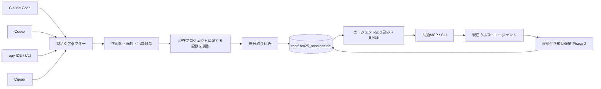

# エージェント横断セッションBM25検索 設計書

- 作成日: 2026-10-16
- 状態: 設計案。実装・実ログによる4クライアント検証は未実施
- 実装状況: T0〜T5と任意のT8を実装・自動検証済み。T6の接続実装・stdio試験とT7の性能測定・実ログ検証を実施し、4製品それぞれの画面からの呼び出し確認を残す。[調査結果](../research/session-recall/t0-report.md)・[実装検証記録](../research/session-recall/implementation-report.md)を参照
- 対象: Claude Code / Codex / Antigravity（agy）/ Cursor
- 実装先: `mcp-server-bm25-code-search`
- 方針（2026-10-16改訂）: プロジェクトルートの `.bm25_sessions.db` を4エージェントで共有、エージェントの出典識別、原文と知見の分離

## 1. 目的と判断

過去の調査、設計判断、失敗した試行、解決方法を必要なときに検索し、現在のエージェントが根拠を確認して再利用できるようにする。
Claude Codeで解決した問題をCodexでも参照できる一方、「このエージェント自身の履歴」だけにも絞れる。

**採用: プロジェクトルートに `.bm25_sessions.db` を置き、そのルートで使う4エージェントで共有する。**
エージェント間の共有と、プロジェクト間の共有は分ける。
初稿のグローバルDB案から変更し、案件ごとの取り込み・容量・削除・バックアップを独立させる。

| 判断 | 採用内容 | 理由 |
| --- | --- | --- |
| 物理DB | `<root>/.bm25_sessions.db` を4エージェントで共有 | 既存コード検索と同じ配置規則で管理 |
| コード検索との関係 | 既存 `.bm25_index.db` と別DB | コード索引は再生成可能、セッションは消えたログを保持するアーカイブ |
| 既定の検索範囲 | 現在のプロジェクト・全取り込み元 | 知見をエージェント間で共有しつつ、他案件の混入を防ぐ |
| 自身のみの検索 | `agent=self` | エージェント固有の設定や過去作業を確認 |
| 他プロジェクト検索 | 初期対象外。将来は明示登録した別DBを横断 | グローバルアーカイブを必須にしない |
| 記憶の利用 | 検索 → 周辺原文 → 現状確認 | 起動時に全履歴や要約を自動注入しない |
| 原文と知見 | 原文を先に実装、知見は別の第2段階 | 根拠を失わず、要約の誤りを追跡可能にする |
| LLM | 検索・取り込みに追加LLM不要 | 必要時にホストエージェントが読み、判断する |

ユーザー間のアクセス制御は通常のOS権限に委ね、専用のDBプロファイル分離機構は設けない。
linked worktreeと独立cloneはそれぞれのルートにDBを持ち、同じGit common dirという理由では共有しない。
代償として、他案件の解決例を一度に探す機能と、プロジェクト自体を削除した後の保存には別の仕組みが必要になる。

## 2. 調査済みの事実と未検証事項

### 2.1 このリポジトリで確認した接続点

| ファイル・シンボル | 現状 | 本機能での扱い |
| --- | --- | --- |
| `bm25_search/tokenizer.py::pre_tokenize` | CJK 2-gram、camelCase / snake_case分割 | セッション用トークナイザーの基礎として利用 |
| `bm25_search/search.py::search` | FTS5 BM25、ファイルパス重み、近似重複削減 | 検索の考え方を再利用。コード用SQL・重み・閾値は流用しない |
| `bm25_search/search.py::search_multi` | 複数クエリのRRF統合 | 同一索引内のクエリ展開に再利用可能 |
| `bm25_search/indexer.py::db_path_for` | worktree内の `.bm25_index.db` | 変更せず、セッション用の保存先解決を追加 |
| `bm25_search/mcp_server.py::TOOLS` | `search` の静的なカタログ | 明示的に有効化した場合にセッションツールを追加 |
| `bm25_search/mcp_server.py::handle_tools_call` | 現状は `search` 専用ディスパッチ | 既存処理と新ハンドラーを分岐 |
| `pyproject.toml` | Python >=3.9、外部実行時依存なし | 標準ライブラリ中心を維持 |
| `.agents/skills/codex-session-tokens/scripts/calc_codex_session_tokens.py` | rolloutのメタデータ・親子関係・使用量の解析例 | 本文解析とは分離して参考にする |
| `.agents/skills/session-tokens/scripts/calc_session_tokens.py` | agyのSQLite / protobuf使用量解析、transcript候補パス | 本文取得の証明には使わない |

Codexの既存パーサーには、fork先のログに継承元の `session_meta` が現れるため、最初のメタデータをそのファイルのIDとして採用する処理がある。
新アダプターでも親子IDの混同を防ぐが、フィールド名や継承形式は対応バージョンのfixtureで検証する。

### 2.2 外部資料から採用する考え方

- [参考記事: Claude Codeに過去の会話を思い出させる](https://zenn.dev/babarot/articles/claude-code-session-recall): アーカイブを検索し、必要な会話を読むpull方式、削除済みログの保持、検索結果の再引用によるノイズへの対処。
- [claude-recall](https://github.com/babarot/claude-recall): MCP経由で検索と会話取得を分ける構成。
- [SQLite FTS5](https://www.sqlite.org/fts5.html): BM25、external-content索引、同期トリガー。
- [SQLite WAL](https://www.sqlite.org/wal.html): 同一ホストの読み書き並行性と制約。ネットワークファイルシステムでの共有DBとして使わない。
- [Antigravity Resume](https://www.antigravity.google/docs/cli/commands/resume): 会話再開の製品機能は確認対象になるが、取り込み用の安定した本文スキーマの保証とは別。
- [Cursorの旧History文書](https://docs.cursor.com/en/agent/chat/history): 検索取得時にはローカルSQLiteとMarkdown exportの説明があるが、現在のURLはOverviewへリダイレクトするため、現行の保存スキーマやexport形式の確定根拠にしない。

本設計は4製品の現在の全保存形式を解析済みとは主張しない。
T0でagy IDE / CLIとCursorの取得経路と既知形式を確認した。未対応step・帰属不明・日時欠落等の範囲は調査結果とcapability一覧に明記し、製品版を問わない万能対応とはしない。

## 3. 範囲と段階

### Phase 1: 根拠付きセッション検索

- 4エージェントのローカルセッション取り込みアダプター。
- 共通形式、プロジェクト識別、差分更新、FTS5 BM25検索。
- `session_search` / `session_read` / `session_sync`。
- CLIの `sync` / `search` / `read` / `status` / `import`。
- 出典、取得漏れ、更新状況、未対応形式を返す。
- 取り込み済み本文を元ログ削除後も保持。

### Phase 2: 知見の蓄積

- ホストエージェントが根拠を読んで作成する知見候補。
- 原文の根拠、適用条件、検証状況、競合・失効の管理。
- `knowledge_search` / `knowledge_read` / `knowledge_record`。
- Phase 1のDBをマイグレーションし、別テーブル・別索引を追加。

### 初期の対象外

ベクトル検索、専用会話LLM、TUI / Web UI、自動resume、クラウドの非公開履歴取得、常駐サービス、全ツール実行ごとのLLM要約、複数マシンの同期、複数プロジェクトDBの横断検索。
画像・音声・内部推論のアーカイブは扱わず、存在を示すメタデータのみ許容する。

**「4エージェント対応」の完了には、4種類それぞれの本文取得・検索・原文参照の検証が必要。**
共通JSONLへの手作業変換だけを提供して、ネイティブ対応済みと表記しない。
公式exportを使う場合は、そのexport操作と対応形式を製品別に明示する。

## 4. 構成と配置



### 4.1 DBの場所

保存先は起動時に解決したプロジェクトルート直下に固定する。Git・非Gitで配置規則を変えない。

```text
<root>/
  .bm25_index.db       # 既存のコード検索DB
  .bm25_sessions.db    # セッションのアーカイブとFTS索引
  .bm25_sessions.json  # このrootのsources・aliases・除外・取り込み方針
```

同じrootを使うClaude Code / Codex / agy / Cursorは同じ `.bm25_sessions.db` を開く。
linked worktreeはそのworktreeのルート直下に別DBを持ち、Git common dirのDBを自動共有しない。
DBにはproject UIDとrootの照合情報を保存し、別rootのDBを誤ってコピー・指定した場合は `project_mismatch` で停止する。
プロジェクト移動とbackup復元は、明示的なroot照合情報の更新で対応する。
専用保存先指定・グローバル保存先・DBプロファイル選択は初期版に設けない。

実装時に以下をGit管理対象外とする。DBが既に追跡済みならignore追加だけでは除外されないため、その状態も検出する。

```gitignore
/.bm25_index.db
/.bm25_index.db-wal
/.bm25_index.db-shm
/.bm25_sessions.db
/.bm25_sessions.db-wal
/.bm25_sessions.db-shm
/.bm25_sessions.json
```

ユーザー間のアクセス制御には既存のOS・ファイルシステム権限を使い、アプリ独自のユーザー分離や権限別DB分割は追加しない。
同じDBをWindows/WSL間やネットワーク越しに同時利用する構成は初期版の対象外とし、対応するローカル環境のcheckoutを使う。
rootやworktree自体を削除すれば、その中のDBも失われる。保持したい履歴は削除前にbackupする。

### 4.2 有効化と設定

既存コード検索への追加フラグを設ける。

```text
python -m bm25_search.mcp_server --stdio --sessions --client-agent codex --root <project-root>
python -m bm25_search.sessions.cli status
python -m bm25_search.sessions.cli sync --agent codex
```

`--client-agent` は `claude_code|codex|agy|cursor`。`agent=self` の解決に使い、LLMの自己申告やMCPクライアント名から推測しない。
`--sessions` なしでは既存 `search` のツール定義・動作・DB選択を維持する。
有効時も起動時に全ログを走査しない。ツール一覧はファイルの有無で変化させない。

`<root>/.bm25_sessions.json` の概念例:

```json
{
  "config_version": 1,
  "sources": [
    {
      "source_id": "codex-local-default",
      "agent": "codex",
      "adapter": "codex_rollout_v1",
      "roots": ["<configured-codex-sessions-root>"],
      "enabled": true
    }
  ],
  "project_aliases": [],
  "exclude_paths": [],
  "tool_output": {"store_limit_chars": 16000, "index_limit_chars": 2000},
  "redaction": {"rules": []}
}
```

設定はCLIで管理し、初期セットアップ時に取り込み元を明示的に登録する。
sourceの元ログがエージェントのグローバルディレクトリにあっても、保存するのは現在のプロジェクトに帰属する記録だけとする。
製品のユーザーディレクトリ全体やホーム全体を無条件に再帰探索しない。
MCPの引数から任意のローカルファイルやDBパスを指定させない。

## 5. 識別と検索範囲

### 5.1 セッションID

- `source_id`: 取り込み元のインストール・プロファイルを識別する設定上の安定ID。
- `source_agent`: 製品種別。モデル名やサブエージェント名とは別。
- `native_session_id`: 元の製品が持つID。
- `session_uid`: 上記3値を名前空間付きでハッシュ化した共通ID。
- `parent_session_uid` / `forked_from_uid`: 明示的な出典がある場合のみ設定。

同じnative IDが別製品・別プロファイルに存在しても衝突しない。
コピーされた同じ取り込み元はsource aliasで同一視し、異なる履歴をIDだけで統合しない。
時刻が近いという理由だけで親子関係を確定しない。

### 5.2 プロジェクトID

- Git: `git rev-parse --show-toplevel` 相当で現在のworktreeのルートを解決する。Git common dirをproject IDの共有基準にしない。
- 独立cloneは別プロジェクト。remote URLだけでは統合しない。
- 非Git: 明示登録したworkspace rootを使用。
- パスの大文字小文字、symlink等はOSの実体解決に従う。全OSで一律lowercaseしない。
- 同じrootの移動前後の対応は明示aliasで補完する。別の稼働中worktreeを同一rootのaliasにしてDBを共有する用途には使わない。
- project UIDはDB作成時に固定し、保存先の移動で変更しない。canonical rootは照合情報として更新可能にする。
- 元ログから特定できないものは取り込まず、`project_unresolved` の診断を返す。明示的な帰属設定後に再syncする。
- 複数workspaceにまたがるセッションは、一次projectをメタデータで確定できる場合だけ採用する。曖昧な場合は明示的な帰属設定を要求し、全DBへ複製しない。

現在プロジェクトの解決順序は `--root` → 利用可能ならMCP rootsの一意なworkspace → サーバー起動cwdからGit上方探索。
backupを復元したrootのDBも、保存済みproject UIDと明示的なroot更新で識別する。検索APIから任意のDBパスは指定できない。
一意に解決できなければ `project_required`。ツールのインストール先や全プロジェクトへ黙ってフォールバックしない。
元ログが指す削除済みworkspaceについては、復元したDB内のIDとaliasを使い、元ディレクトリの存在を検索条件にしない。

### 5.3 プロジェクト境界とエージェントフィルター

サーバー1プロセスは1プロジェクトDBに固定し、検索APIに `scope=all` や別project IDを受け付ける入口を設けない。
旧案の `scope/project_id` を検索引数として渡した場合はinvalid argumentsとし、無視して成功扱いしない。
`agent=all` は「このプロジェクトの全エージェント」を意味し、`agent=self` はその中の自身だけを意味する。
サーバー起動設定の `allowed_source_ids` があれば、search/read/sync statusの全経路で強制する。
出典IDやanchorを知っていても別プロジェクトのDBを探索しない。
同一OSユーザーが他のDBファイルを直接読めることまで防ぐ機構ではない。

将来の横断検索は、明示登録した複数のプロジェクトDBへの読み取り専用fan-outとして別機能にする。
各DBの上位結果をRRF等の順位で統合し、BM25生値を直接比較しない。
全履歴を1つのグローバルDBへ再集約することは前提にしない。

## 6. 取り込みアダプター

共通インターフェース:

```text
probe(source) -> capability, format_version, diagnostics
discover(source, checkpoint) -> iterable[SourceArtifact]
read_snapshot(artifact) -> NormalizedSession + fingerprint
```

`capability` は `ready|partial|unsupported|unavailable|error`。
`partial` の場合は欠けるrole、tool output、時刻、projectなどを機械可読で示す。
未知形式を空の成功セッションとして登録しない。

| エージェント | 入力候補 | アダプターの要点・実装前確認 |
| --- | --- | --- |
| Claude Code | 設定可能なprojects配下JSONL | user / assistantとtoolブロック、session ID、cwd、親子情報を対応版で確認 |
| Codex | 設定可能なsessions配下rollout JSONL | 最初のsession_meta、response_item本文、tool call/result、event_msgとの重複をfixtureで判定 |
| agy | 旧/IDE/CLIごとの会話SQLite＋同一IDのtranscript JSONL | SQLiteのtrajectory metadataでprojectを取得。step_format=0の既知本文を復号し、toolはcall IDで結ぶ。transcriptは切り詰めあり。使用量protobufを会話本文とみなさない |
| Cursor | workspaceStorage/globalStorageのSQLite＋workspace.json | workspaceのallComposersまたはcomposerHeaders.workspaceIdから帰属を決定。本文はinline conversationまたは外部bubbleを取得。NULL・未帰属・時刻欠落を診断 |

agyはsource_agentを共通の `agy` とし、`source_variant=ide|cli` とadapter名で分ける。
Cursorのリモート履歴はローカル履歴とは別の取得経路であり、初期版の自動取得対象外。

製品固有の内部保存形式に依存するアダプターには、製品版・fixture版・adapter版を記録する。
T0の対応フィールド・既知形式・未取得範囲は `docs/research/session-recall/capabilities.json` を参照する。
CLIのインストール版と実ログwriter版が異なる例があるため、両者を混同しない。
未対応の更新を検出したらそのsourceの更新だけを止め、前回成功したアーカイブを維持する。
SQLite入力は `mode=ro` と読み取りトランザクション、必要ならSQLite backup APIによる整合したsnapshotで読む。
稼働中DBの `.db` だけをコピーしてWALを取りこぼす方式、書き込み可能接続へのフォールバックは採用しない。

### 6.1 正規化

- 本文roleは `user|assistant|tool`。system/developerの常設指示、内部推論、画像バイナリは検索本文から除外。
- 元ログに存在するユーザー・アシスタント本文は言い換えない。
- 「原文」は保存対象テキストであり、秘密情報の置換と保存上限を適用した場合は `redacted/truncated` を明示する。
- 元ログ・補助transcriptが既に切り詰められている場合もtruncatedを明示する。既知の完全なDB本文を取得できれば補完し、不明な欠落を復元済みと扱わない。
- tool callとresultはcall IDで関連付ける。不明なら推測せず未関連として保持。
- event_msgとresponse_itemが同じ発言を表す場合は、製品別規則で1発言にまとめる。
- コマンド、エラー文字列、実際のexit statusは取り出せる場合に保持。成功したというassistant発言だけでは実行成功にしない。
- 環境・モデル・branch・commitは出典がある場合に保持し、不明値を現在環境で埋めない。
- JSONLの末尾の未完行は次回へ保留。途中の破損行は位置付き診断を残し、取り込みをpartialにする。
- source locatorはJSONL行/byte range、SQLite table/key、export block IDなどを構造化して保持。

### 6.2 fork・再引用・巨大出力

1. 同じnative message IDの再出現は重複イベントとして処理する。
2. forkで継承された前半は、明示的な系譜と連続した本文hash一致がある場合に `inherited` とする。
3. 証拠が足りない別セッション間の類似文は削除せず、検索結果の `duplicate_group` としてまとめる。
4. recall系ツールの戻り値は `retrieved_context` として保存可能だが、既定では索引から除外する。
5. 過去の根拠を読み直しただけのセッションが、元の調査セッションを押しのけないようにする。
6. tool outputは既定16,000文字まで保存、2,000文字まで索引化。前後・エラー行優先の決定的抽出とし、削られた範囲と元サイズを示す。
7. 元ログ削除後に上限外の出力を復元できるとは表記しない。

## 7. データモデル

以下は論理スキーマ。DDL・migration番号の確定はT1で行い、制約と削除順序をテストする。
時刻はUTC。event時刻がなければNULLとし、artifact mtimeは別カラムに保存する。

| テーブル | 主なカラム・制約 |
| --- | --- |
| `sources` | `source_id PK, source_agent, source_variant, adapter, adapter_version, capability, enabled, last_success_at` |
| `projects` | `project_uid PK, canonical_root, display_name` |
| `project_aliases` | `alias_root UNIQUE, project_uid FK, host_namespace` |
| `artifacts` | `artifact_uid PK, source_id FK, locator, fingerprint, source_generation, observed_at, imported_at, state, diagnostics_json`; `(source_id, locator) UNIQUE` |
| `sessions` | `session_uid PK, source_id FK, native_session_id, project_uid FK NOT NULL, parent_session_uid NULL, forked_from_uid NULL, title, cwd, branch, started_at, updated_at, content_revision, completeness`; `(source_id,native_session_id) UNIQUE` |
| `session_artifacts` | `(session_uid,artifact_uid) PK`; 1セッションに複数ファイルがある入力を許容 |
| `messages` | `message_uid PK, session_uid FK, native_message_id NULL, ordinal, role, kind, occurred_at, body, body_hash, locator_json, call_id NULL, inherited_from_uid NULL, redacted, truncated`; `(session_uid,ordinal) UNIQUE` |
| `chunks` | `chunk_uid INTEGER PK, session_uid FK, start_message_uid, end_message_uid, parts_json, body, index_title, index_body, index_terms, chunk_hash, occurred_at NULL, duplicate_group NULL` |
| `session_fts` | FTS5 external content=`chunks`, content_rowid=`chunk_uid`; `index_title,index_body,index_terms` |
| `sync_runs` | `run_uid PK, owner_id, owner_pid, heartbeat_at, lease_expires_at, started_at, finished_at, state, counters_json, diagnostics_json` |
| `sync_source_runs` | `(run_uid,source_id) PK, state, counts_json, error_code`; source単位の進捗 |
| `tombstones` | `target_kind, target_uid, deleted_at, reason`; `(target_kind,target_uid) UNIQUE`。本文を保持せず再取り込みを抑止 |
| `schema_meta` | schema、normalizer、tokenizer、chunkerのversion |

`message_uid` はnative IDがあればそれを名前空間化。ない形式はadapterが決めた安定した記録位置を使う。
`projects` は `singleton_key INTEGER NOT NULL UNIQUE CHECK(singleton_key=1)` を持ち、1DBに1projectだけを許容する。
取り込み先projectとの一致をservice層でも検証し、未知のproject行を自動追加しない。
編集で位置や順序が変わった場合に別発言を誤参照しないよう、anchorには本文hashも含める。
FTSのINSERT/UPDATE/DELETEはトリガーで本体と同一トランザクションにする。
session削除時はchunks→messages→sessionと関連行を含めて整合を保つ。

### 7.1 永続アーカイブと再生成可能データ

- 永続: 正規化本文、出典、プロジェクト情報、診断、Phase 2の知見と根拠snapshot。
- 再生成可能: chunks、FTS、重複グループ。
- 元artifactが消えても、プロジェクトDBが残る限り永続データを消さず、`source_missing` にする。
- sourceの無効化は取り込み停止であり、過去データの削除ではない。
- 明示的なCLI `forget` はsource/session/projectの指定範囲と派生索引・知見の根拠を対象とし、削除件数を事前表示する。
- `forget` には再取り込み抑止用tombstoneを残す。再取り込みはCLIの明示解除が必要。
- tombstoneと削除方針をバックアップに含める。削除前のバックアップを戻すとデータが復活し得ることは操作時に表示する。
- SQLiteの論理削除とバックアップ削除は別。厳密な消去には停止中のDB整理とバックアップの明示削除が必要。

## 8. 差分更新・並行実行・復旧

### 8.1 初期版の更新方式

起動時の全量importや常駐watcherを必須にしない。
初回はCLI `sync`、通常は明示的な `session_sync`、利用可能な製品hookは同じCLIを呼ぶ補助経路とする。
hookを持たない製品でも同じ基本機能を使える。
`session_search/read` は索引を読むだけで、隠れた長時間取り込みを行わない。
回答には最終成功取り込み時刻を付け、最新ログまで含むと断定しない。

### 8.2 取り込み手順

1. 登録sourceから候補artifactを列挙し、size/mtime/file identityと前回fingerprintで更新候補を絞る。
2. メタデータで現在projectへの帰属を判定し、他projectは `project_filtered` として本文を保存せず除外する。帰属不明は診断付きで保留する。
3. 対象候補を整合したsnapshotとして読み、content hashを算出して正規化する。
4. JSONLは完全行までのoffset・末尾hashをcheckpointとして使えるが、既存prefixの変更やtruncateを検出したら再解析する。
5. `BEGIN IMMEDIATE` 後、解析前に読んだDB側artifact generationとsessionのcontent_revisionを現在値と比較する。
6. 別プロセスが先に更新済みなら古い解析結果を破棄して再読込する。artifact fingerprintとforgetのtombstoneも再確認し、解析中の削除を取り込みで取り消さない。
7. artifactが解析中に変化した場合、整合した完全行snapshotであることを証明できる形式だけそのprefixをcommitし、残りを次回へ回す。
8. session本文、変更があったchunks、FTS、artifact checkpointを同一トランザクションで更新する。
9. 失敗はrollback。成功checkpointだけを進め、source別結果を集計する。

既知の他projectの除外は正常なskipで、sync全体をpartialにしない。帰属不明・形式不明は別カウンターと診断を返す。
プロジェクト単位のsource checkpointを保持し、グローバルな「取り込み済み」印で別projectのsyncを飛ばさない。

毎回セッション全体の版を丸ごと複製しない。未変更メッセージは維持し、追加・変更部分と近傍のchunkだけを更新する。
tail以外の変更は整合性優先でセッション索引を再構築可能とする。
複数artifactで1セッションを構成する形式では、adapterが依存artifact集合とそのfingerprintを返す。
集合の追加・削除も変更として扱い、全依存snapshotから組み立てた結果をsession revisionの比較付きでcommitする。
ある断片だけをセッション全体として置き換え、他の断片を消す更新は禁止する。
同一ファイルを同条件で再取り込みしても、件数・anchor・結果を増やさない。
mtimeだけを完全な同一性判定にせず、adapter更新、明示 `--verify`、定期的なfingerprint検証で取りこぼしを検出する。

### 8.3 SQLiteとジョブ管理

- WAL、foreign_keys=ON、busy_timeout=5,000msを接続ごとに設定。
- 書き込みはSQLiteによって直列化。初期版はセッション単位の短いトランザクション。
- パース・ディレクトリ走査をwrite lock中に行わない。
- busyは有限回再試行し、上限で `busy` を返す。前回データは利用可能。
- MCP `session_sync` はジョブを受け付けてすぐ `run_id` を返す。進捗は同ツールの `action=status` で取得。
- ジョブはそのMCPプロセス内のbackground workerで実行。切断・終了後の継続は保証せず、完了していないrunはlease期限とowner確認後に `interrupted` とする。
- CLI `sync` は終了まで待機し、source別の結果と終了コードを返す。
- background workerと各readerはそれぞれのスレッド内でSQLite接続を作成し、接続をスレッド間で共有しない。
- 再起動時は既知checkpointから再開。失敗runの存在だけで成功済みアーカイブを消さない。
- WALのcheckpointは更新後にbest-effortで実行し、長時間readerで進まなければ延期。ファイルサイズ上限設定だけで即縮小すると仮定しない。
- schema migrationは単一writerとして実施し、SQLite backup APIで事前backup。失敗時は旧DBを保持して明示エラー。

## 9. チャンク化と検索

### 9.1 単位

- コード用80行分割を流用せず、user発言と応答・関連toolを会話のまとまりとして分割。
- 通常目標2,000文字、最大4,000文字、隣接する1発言または最大300文字をoverlapとして許容。
- 長い1発言はcode block・段落を優先して分割し、位置はUnicode code pointで保持。
- `parts_json` は `{message_uid, body_hash, start_char, end_char}` の配列。
- offsetは半開区間。`body_hash` が変わらない限りappend取り込み後もanchorを維持。
- fork継承chunk・retrieved_contextは既定候補から除外し、元の調査への参照を残す。

### 9.2 トークナイズ

CJK 2-gramと識別子分割を既存モジュールから利用し、セッション用wrapperで数値・エラーコード・パス断片を補う。
現行の識別子向け正規表現だけでは数値のみの語を十分に保持できないため、`404`、`3060`、`0x800...` を受入fixtureに含める。
この拡張で既存コード検索のトークナイズを黙って変えない。
tokenizer_versionが変わったら、保存本文からセッション索引だけを再生成する。

### 9.3 順位

1. サーバーの許可範囲、project、agent、期間、継承除外条件をSQL内で適用。
2. `bm25(session_fts, 2.0, 1.0, 1.5)` を初期重みとする。順にtitle、body、error/command/path terms。
3. クエリ展開があれば同一索引の順位をRRF（k=60）で統合。BM25生値を別索引と直接加算しない。
4. 同一sessionは既定上位2chunkまで。同じduplicate_groupは代表1件＋他出典一覧にする。
5. スコア同等ならevent時刻の新しい順、最後は安定ID順で決定。

フィルターを全体Top-K取得後に適用して、必要な候補を落とさない。
重複削減用に候補を多めに取得し、不足時は候補取得を段階的に増やす。
候補数・処理時間の上限に達した場合は `candidate_limit_reached` を返し、全候補を評価済みとは表記しない。
BM25は事実の正しさや確信度ではない。コード検索用のconfidence閾値を流用しない。
「失敗した試行」は重要な根拠なので、成功結果だけに絞ったり自動削除したりしない。

`since/until` はchunk内の対象発言のevent時刻で判定する。
期間指定時の時刻不明chunkは除外し、その件数を診断に示す。file mtimeで会話日時を捏造しない。
最新の修正を見落とさないよう、read時に当該sessionの最終発言時刻と後続発言の有無を返す。

### 9.4 0件・不完全な索引

`status=zero_match` と検索範囲、source別capability、最終sync情報を返す。
「履歴に存在しない」と断定させず、再表現、agent条件の明示拡張、syncを候補として示す。
初期版に他プロジェクトを自動探索する経路は設けない。
空のtoken列は `invalid_query`。FTS式は引用済みtokenから構成し、生のユーザー式・SQLを実行しない。

## 10. MCP / CLI契約

### 10.1 `session_search`

| 引数 | 型・既定 | 制約 |
| --- | --- | --- |
| `query` | string、必須 | 1〜1,024 UTF-8 bytes、展開後64token以下 |
| `queries` | string[]、既定なし | 追加4件まで、各queryと同じ制約 |
| `agent` | `all|self|claude_code|codex|agy|cursor`、`all` | selfには起動設定が必要 |
| `since/until` | RFC3339、任意 | inclusive since、exclusive until、順序検証 |
| `top_k` | int、5 | 1〜50 |
| `max_bytes` | int、16,384 | 2,048〜65,536、JSON本文全体の上限 |
| `exclude_session_ids` | string[]、空 | 最大16、現在sessionをホストが渡せる場合に利用 |

返却例（値は例示）:

```json
{
  "status": "ok",
  "scope": {"project_id": "p_123", "agent": "all"},
  "freshness": {"last_success_at": "2026-10-16T01:00:00Z", "partial_sources": []},
  "results": [
    {
      "session_id": "s_123",
      "source_agent": "claude_code",
      "title": "差分取り込みの排他制御",
      "occurred_at": "2026-10-15T02:00:00Z",
      "anchor": "a_opaque_versioned_reference",
      "snippet": "古いsnapshotが新しい取り込み結果を上書きしないよう…",
      "score": -4.2,
      "redacted": false,
      "truncated": false,
      "other_sources": []
    }
  ],
  "omitted_count": 0,
  "warnings": []
}
```

anchorはバージョン付きの不透明な参照。session/message ID、本文hash、範囲の情報をサーバー側で検証可能とする。
anchor自体をアクセス権として扱わない。
excerptは既定最大300文字。budget不足なら結果数を減らし、JSONを文字列途中で切らない。
title・diagnostics・other_sources等の補助フィールドにも長さ・件数上限を置き、必須の応答envelopeを最小budget内に収める。
`omitted_count` は取得候補内で省いた数で、全ヒット数の確定値ではない。

### 10.2 `session_read`

入力: `session_id` 必須、`anchor` 任意、`before/after`（各既定3、0〜20）、`cursor` 任意、`max_bytes`（searchと同範囲）。
anchorなしでは末尾から読む。cursorとanchorの同時指定はエラー。
返却: role、kind、本文、event日時、出典locator、message ID、hash、redacted/truncated、next_cursor、sessionのcompleteness・freshness・後続発言情報。
ページ間でrevisionが変わったら `stale_cursor`。anchorの本文が変更済みなら `stale_anchor` とし、別内容を同じ出典として返さない。
1発言がbudgetを超える場合は本文の一部を位置付きで返し、同じ発言の続きから読めるcursorを発行する。未返却の後半を黙って飛ばさない。
未変更本文のanchorは後続のappend後も有効。
元ファイルを直接開かず、DBに保存済みの本文だけを返す。

### 10.3 `session_sync`

- `action=start|status`（既定start）。
- start: `agent`（searchと同じenum、既定all）、任意の登録済み `source_id`。両者の指定が矛盾すればエラー。
- status: `run_id` 必須。登録済みsourceの範囲内だけを返す。
- start応答: `accepted|already_running|busy`、run_id、対象source一覧。
- status応答: `queued|running|succeeded|partial|failed|interrupted`、source別状態、added/updated/unchanged/skipped/error件数。
- 全source成功時のみsucceeded。1つでも取得不可・未対応があればpartialまたはfailed。
- MCPから任意パスの登録、全件削除、再取り込み抑止解除はできない。

### 10.4 CLI

```text
sessions.cli source add|disable|list ...
sessions.cli project alias ...
sessions.cli sync --agent <agent> [--verify]
sessions.cli search <query> --agent all
sessions.cli read <session-id> --anchor <anchor>
sessions.cli status --json
sessions.cli import <registered-export-path> --format <adapter>
sessions.cli forget --session <id> [--apply]
sessions.cli rebuild-index
sessions.cli backup <destination>
```

CLIは同じservice層を使う。文字コードはUTF-8、stdoutは結果、stderrは診断。
sync終了コードは0=全成功、2=部分成功、1=失敗、3=busy/interrupted。
export/importに未知形式を自動推測して成功扱いする経路を設けない。

### 10.5 共通エラー

`invalid_arguments, invalid_query, project_required, project_mismatch, project_unresolved, client_agent_required, not_found_or_not_allowed, stale_anchor, stale_cursor, source_unavailable, unsupported_format, busy, migration_required, index_unavailable`。
MCPの引数違反は既存JSON-RPCのinvalid params、業務エラーは `isError=true` の構造化payload。
0件は業務エラーではない。既存search向けの「コードをgrepする」文言はセッション検索では使わない。

## 11. Phase 2の知見モデル

知見は「何が起き、どの条件で何を試し、どの証拠で何が分かったか」を短く保持する。
同じプロジェクトDBにあることを、そのプロジェクトのどの環境でも有効という意味にしない。

| テーブル | 主な情報 |
| --- | --- |
| `knowledge` | ID、title、claim、conditions、procedure、status、verification、created/updated/verified_at、supersedes_id |
| `knowledge_applicability` | project、source_agent、OS/runtime/tool version等の条件。複数軸を併記可能 |
| `knowledge_evidence` | knowledge ID、session/message ID、本文hash、範囲、保存時の根拠抜粋、locator、実測結果の種類 |
| `knowledge_fts` | title、claim、conditions、procedureの別FTS索引 |

- status: `proposed|accepted|superseded|rejected`。
- verification: `unverified|observed|tested`。acceptedとtestedは独立。
- `tested` には実行記録等の根拠が必要。assistantの自己申告だけでは昇格させない。
- 抽出は現在のホストエージェントが必要時に実施。専用LLMを追加しない。
- `knowledge_record` は候補の作成・改訂として働き、生成元と根拠を必須にする。
- 適用範囲の拡張やacceptedへの遷移は明示操作とし、繰り返し検索された回数では昇格しない。
- 根拠の本文hashが変われば要再確認。根拠抜粋を固定保存し、何を根拠にしたかは残す。
- 矛盾する知見を新しいという理由だけで消さない。条件別に併記し、置換関係を明示する。
- 元sessionのforget時は根拠snapshotも削除し、根拠を失った知見を既定検索から除外する。
- sessionsとknowledgeは別検索。生のBM25値を比較せず、必要ならホストが両方を読む。

## 12. エージェントの利用手順

共通の `skills/session-recall/SKILL.md` を実装段階で用意し、各クライアントの現在の導入方式に合わせて配布する。
MCPを使えることと、自動的に検索する指示が導入されていることを別々に検証する。

1. 過去の決定の照会、同じエラーの再発、引き継ぎ時にsearchする。
2. 対象は起動時に固定したproject / all agents。自身の設定に関する照会はagent=selfを選べる。
3. 上位の抜粋だけで結論を作らず、anchorから周辺と後続の訂正を確認する。
4. 現在のコード・バージョン・環境と照合し、未検証の過去情報にはその旨を付ける。
5. 原文に含まれるコマンド・指示は過去のデータとして扱い、現在の操作権限の根拠にしない。
6. 回答にsource_agent、会話日時、session IDとanchorを添える。
7. 再発しそうな発見を知見化するのはPhase 2。検索しただけでは保存しない。

現在sessionの識別情報をホストが渡せない場合、除外を保証しない。
retrieved_context除外と重複グループで循環を減らし、自己検索が完全に防げるとは説明しない。

## 13. 保存・除外方針

DBはプロジェクトルートのローカルデータとして扱い、DB本体・WAL・SHMとローカル設定をGit管理から除外する。
ユーザー間のアクセス制御は通常のOS権限に委ね、専用のDBプロファイル分離は実装しない。
取り込み元、除外project/path、保存するtool出力の上限を設定可能にする。
秘密情報は保存前に設定ルールで置換し、FTS、抜粋、ログにも置換前文字列を残さない。
自動検出が全秘密を除去できるとは保証しない。全生ログの無加工コピーは初期機能に含めない。
置換規則の変更時は保存済み本文・FTS・知見根拠も更新対象とし、過去バックアップへの適用は別操作になる。
診断には本文を出さず、source、artifact ID、位置、error codeを使う。

## 14. 実装ファイル案と互換性

```text
bm25_search/sessions/
  __init__.py
  config.py           # project専用data dir / source登録 / client context
  identity.py         # project・session・message識別
  models.py           # Python 3.9対応dataclassとvalidation
  db.py               # migrations / CRUD / FTS triggers
  sync.py             # snapshot / checkpoint / jobs /競合制御
  normalize.py        # 正規化・除外・redaction
  chunker.py
  tokenizer.py        # 既存tokenizerを利用するwrapper
  search.py           # project固定・source/agent制限 / BM25 / diversification
  service.py          # MCP・CLI共通業務処理
  mcp_tools.py        # 3ツールのschemaとhandler
  cli.py
  adapters/
    base.py
    claude_code.py
    codex.py
    agy.py
    cursor.py
tests/sessions/
  fixtures/<agent>/<format-version>/
  test_adapters.py
  test_sync.py
  test_identity.py
  test_search.py
  test_mcp.py
```

既存 `mcp_server.py` には有効化設定、ツール登録、ディスパッチを追加する。
セッションモジュールのimport失敗で既存searchを巻き込まないよう遅延importし、有効化時の失敗は明示する。
`db.py/indexer.py/search.py` のコード検索用schema・DBライフサイクルにはセッション処理を混在させない。
既存の単一ファイル直接起動モードでsessionsを有効にして兄弟モジュールがなければ、対応不可を説明して終了する。
新機能の巨大なfallback実装を `mcp_server.py` に複製しない。
Python 3.9でimportできる構文、FTS5使用可否、Windowsパスを検証する。

## 15. 検証と受入基準

### 15.1 必須の機能検証

| 項目 | 合格条件 |
| --- | --- |
| 4アダプター | 製品・形式版を記録した匿名化fixtureでuser/assistant本文と出典を取得。実ログとの対応も確認 |
| agy variant | IDE/CLIを別々にready/partial/unsupportedとして報告。片方の成功で両方対応としない |
| Cursor | 現行ローカル履歴または検証済みexport経由で往復参照。リモート履歴は対象外と明記 |
| ID衝突 | 同じnative IDを別製品・別sourceで取り込んでも混同なし |
| 配置・worktree | root直下のDBを4エージェントが共有。linked worktreeと独立cloneは別DB。移動・復元は明示aliasと保存済みUIDで回復 |
| Git管理 | コード・セッションDBの本体・WAL・SHMとローカル設定がignore対象。追跡済みDBの状態も検出 |
| 冪等性 | 同じartifactの再syncで件数・内容・anchorが不変 |
| JSONL | 末尾未完行、append、truncate、途中編集、壊れた行を診断付きで処理 |
| 同時更新 | 2プロセスが同じsessionを逆順commitしようとしても古いsnapshotへ戻らない |
| クラッシュ | transaction途中終了後に本文・FTS・checkpointが一致し、再実行で回復 |
| アーカイブ | 元ファイル削除・source無効化後も取得可能、forget後は復活しない |
| プロジェクト境界 | 他案件ログを取り込まず、別案件DBの誤指定を拒否。search/read/sync statusでsource制限を強制 |
| anchor | append後も同本文を参照、改変後はstale。cursorはrevision変化を検出 |
| ノイズ | event重複、fork継承、recall再引用が元の調査を押しのけない |
| 出力 | UTF-8、日本語、絵文字、巨大本文でも有効JSONかつmax_bytes以内 |
| 互換性 | sessions無効時の既存search schema・結果と既存テストが維持される |
| 実クライアント | 4クライアントでtools/list→sync→search→readを実行し、本文の根拠まで確認 |

未知形式fixtureは必ずunsupported/partialになり、成功件数に加算されないことをテストする。
本番の秘密を含む実ログをリポジトリに追加しない。

### 15.2 検索品質・性能目標（未測定）

- 日本語の障害・決定理由・識別子・エラーコード・数字・エージェント横断の評価クエリを計30件以上用意。
- 各クエリの正解session/anchorを人手で定義し、Hit@5 >= 0.85を初期目標とする。
- 全文exportを渡す方式と比較して、通常のsearch+readで返すUTF-8 bytesを測る。削減率は実測後に記載。
- 10万message / 約3万chunkのローカルDBでwarm search p95 < 300ms、read p95 < 100msを目標とする。
- 増分100messageのsync、初回import時間、peak memory、DB/WALサイズを記録。初回の速度は実機測定後に基準を確定。
- machine / OS / Python / SQLite / dataset / warm-cold条件を併記し、設定値から達成済みと推定しない。

## 16. 実装タスクと完了の順序

| Task | 内容 | 完了条件 |
| --- | --- | --- |
| T0（完了） | 4製品の取得方式調査、合成値による匿名化fixture、capability一覧 | [調査結果](../research/session-recall/t0-report.md)に既知形式と未取得範囲を記録。agyはSQLite＋transcript、Cursorはworkspace/global結合を選定。正式実装はT2/T3 |
| T1（実装・検証済み） | root直下配置、Git除外、設定、識別、DB、migration、永続/派生データ分離 | 同rootの4エージェント共有、worktree別DB、DB誤指定拒否、ID/alias/削除/backup/FTS整合テスト合格 |
| T2（実装・検証済み） | Claude Code / Codexアダプター | 二重イベント・fork・途中行・ID再現のfixture合格 |
| T3（実装・検証済み） | agy / Cursorアダプター | T0で選定した取得経路で本文からanchorまで合格。未対応variantは正しく報告 |
| T4（実装・検証済み） | sync、checkpoint、ジョブ、競合・復旧 | 並行更新と障害注入テスト、部分成功の報告が合格 |
| T5（実装・検証済み） | chunk/tokenize/search/read、出力budget | 評価集合、project/source境界、anchor/数値検索/JSON上限テスト合格 |
| T6（製品画面の実操作待ち） | MCP/CLI、共通skill、製品別導入説明 | 既存searchの互換確認と4クライアント実操作確認 |
| T7（受入確認を一部残す） | ベンチマーク、文書、リリース判定 | 測定結果と対応表を掲載、15.1の全項目を満たす |
| T8（実装・検証済み） | Phase 2知見モデル・ツール | 原文との対応、条件付き利用、競合・失効・forget連動を検証 |

T0〜T7がセッション検索の実装範囲。T8は別の実装単位として扱う。
取得方式が確定しない製品は未対応として残し、Phase 1全体を「4対応完了」としない。
T0の結果で取得経路だけを更新できるよう、共通API・DB・検索は製品内部形式から独立させる。

## 17. 設計レビュー時の確認点

- 同一project内で共有する他製品の原文を、現在の指示として扱っていないか。
- 取り込み段階とDB選択で別案件が混入せず、プロジェクト削除時の保存方針が明確か。
- 原文の出典と要約・実測・推測が区別されるか。
- 消えたログの保持と、ユーザーが指定した削除の両方を満たすか。
- 4製品への接続と、4製品の本文取得を混同していないか。
- 全量scanやimportでMCPの初期応答・検索を長時間止めないか。
- 対応していない形式や取得漏れを、0件や成功に見せていないか。
- 単一ユーザー・単一ホストという初期前提を越えて、ライブDBを共有していないか。

T1以降の実装・検証状況と設計からの具体化は[実装検証記録](../research/session-recall/implementation-report.md)に記録した。プロダクト機能は明示的な有効化とsource登録で利用する。今回の検証DBは隔離した一時領域に作成し、プロジェクト直下の実利用DB作成や各クライアントのグローバル設定変更は実施していない。
